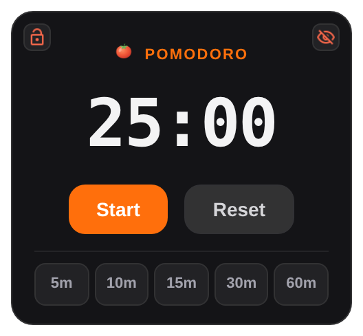

<div align="center">


# Pomodoro-Widget

Ein kleines, schwebendes Pomodoro-Timer-Widget für den Desktop.
Bleibt immer im Vordergrund, stört nicht und meldet sich, wenn die Zeit um ist.




</div>

## Funktionen

- **Timer** mit 25 Minuten als Standard, dazu Schnellauswahl für 5, 10, 15, 30 und 60 Minuten
- **Start / Pause / Reset** über große Buttons
- **Alarm** am Ende: Musik läuft in Schleife, das Fenster taucht wieder auf, blendet sich langsam ein und zeigt „AUFWACHEN!“. Ein Klick auf die Zeit stoppt den Alarm.
- **Durchsichtig einstellbar:** Mausrad über dem Widget ändert die Deckkraft (10–100 %)
- **Verschiebbar:** einfach am Hintergrund ziehen. Mit der Pin-Taste oben links wird das Widget festgepinnt.
- **Ausblenden:** Auge-Taste oben rechts versteckt das Widget im Infobereich (Tray). Ein Linksklick auf das Tray-Icon holt es zurück, im Tray-Menü gibt es „Beenden“.
- Rahmenloses, transparentes Fenster, immer im Vordergrund, ohne Eintrag in der Taskleiste

## Technik

| Bereich | Werkzeug |
| --- | --- |
| Desktop-Hülle | [Tauri 2](https://tauri.app/) (Rust) |
| Oberfläche | [Next.js 16](https://nextjs.org/) als statischer Export, [React 19](https://react.dev/) |
| UI-Komponenten | [HeroUI v3](https://heroui.com/), [Tailwind CSS 4](https://tailwindcss.com/) |
| Sprache | TypeScript |

Next.js wird mit `output: "export"` zu fertigen HTML-Dateien gebaut (Ordner `out/`). Tauri packt diese Dateien zusammen mit einem kleinen Rust-Programm in eine Desktop-App. Das Rust-Programm kümmert sich um Tray-Icon und Menü und holt das Fenster nach vorne, wenn das Frontend das Ereignis `alarm-triggered` sendet.

## Selbst bauen

### Voraussetzungen

- [Node.js](https://nodejs.org/) (LTS)
- [Rust](https://www.rust-lang.org/tools/install)
- Die [Tauri-Voraussetzungen](https://tauri.app/start/prerequisites/) für dein Betriebssystem (unter Windows: Microsoft C++ Build Tools und WebView2)

### Entwicklung

```bash
npm install
npm run tauri dev
```

Das startet den Next.js-Entwicklungsserver und öffnet das Widget-Fenster. Änderungen im Code werden sofort übernommen.

### Fertige App bauen

```bash
npm run tauri build
```

Die Installationsdateien landen danach in `src-tauri/target/release/bundle/` (unter Windows z. B. als `.msi` und `.exe`).

### Weitere Befehle

| Befehl | Zweck |
| --- | --- |
| `npm run lint` | Code mit ESLint prüfen (`npm run lint:fix` repariert, was automatisch geht) |
| `npm run typecheck` | TypeScript-Typen prüfen |
| `npx tauri icon app-icon.png` | App-Icons in allen Größen neu erzeugen |

## Projektstruktur

```text
app/
  page.tsx          Das Widget (Timer, Alarm, Buttons)
  layout.tsx        Grundgerüst der Seite
public/sounds/      Alarm-Sound
src-tauri/
  src/lib.rs        Tray-Icon, Menü, Fenster bei Alarm nach vorne holen
  tauri.conf.json   Fenster-Einstellungen (Größe, transparent, immer oben …)
  capabilities/     Was das Frontend in Tauri darf
  icons/            App-Icons und Button-Grafiken
app-icon.svg        Tomaten-Icon als Vektorgrafik (Vorlage)
app-icon.png        Ausgangsbild für die App-Icons (1024 px)
```

## Lizenz

Der Quellcode und das Tomaten-Icon (`app-icon.svg`) stehen unter der [MIT-Lizenz](LICENSE). Das Projekt ist aus der [HeroUI-Next.js-Vorlage](https://github.com/heroui-inc/next-app-template) entstanden, die ebenfalls unter MIT steht.

### Fremde Inhalte

Diese Dateien sind **nicht** von der MIT-Lizenz abgedeckt, sondern gehören ihren Urhebern:

- **Button-Icons** Schloss offen/zu und Auge (`src-tauri/icons/pin-on.png`, `pin-off.png`, `eye-off.png`): [Icons by Icons8](https://icons8.com/)
- **Alarm-Sound** (`public/sounds/audioclubz-audio-club-amapiano-319840.mp3`): [Audio Club Amapiano](https://pixabay.com/music/beats-audio-club-amapiano-319840/) von [AudioClubz](https://pixabay.com/users/audioclubz-47422145/) auf Pixabay, [Pixabay Content License](https://pixabay.com/en/service/license/)
